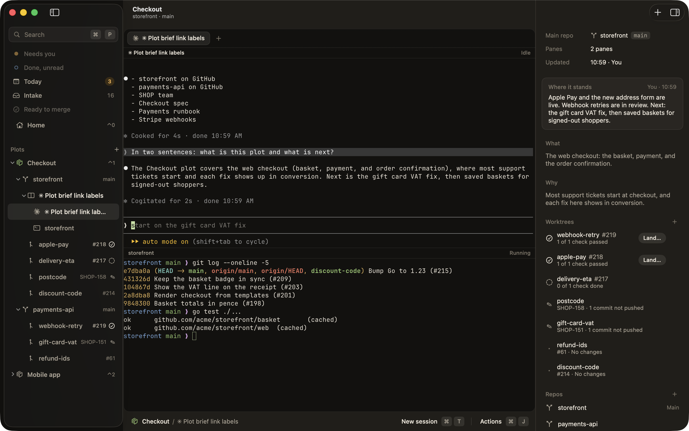

<p align="center">
  
</p>

<h1 align="center">Loam</h1>

<p align="center"><b>A macOS app that has Claude Code work through your issues in the background, and brings each result to you to review and merge.</b></p>

<p align="center">
  <a href="https://gregormcc.github.io/loam/">Website</a> ·
  <a href="#install">Install</a> ·
  <a href="docs/guide.md">Guide</a> ·
  <a href="docs/how-it-works.md">How it works</a> ·
  <a href="docs/cli.md">The loam CLI</a> ·
  <a href="CONTRIBUTING.md">Contribute</a>
</p>

<p align="center">
  <picture>
    <source media="(prefers-color-scheme: dark)" srcset="docs/images/hero-night.png">
    <source media="(prefers-color-scheme: light)" srcset="docs/images/hero-day.png">
    
  </picture>
</p>

## What Loam does

You pick the work. Claude does it in a background session, in its own worktree, until your checks pass. Loam opens the PR and reads CI. Then you review the result and merge it, or send it back with notes.

Each run moves along the line. It stops for you only where a person must decide.

<p align="center">
  
</p>

- **Intake.** The open work of a plot: its Linear issues, GitHub issues, and wayfinder tickets. Select items and shape them, or start one at once as a chore.
- **Shape.** Claude drafts the run: the goal, a plan, the Done when checks, and the repo. You approve it, or ask Claude to change it.
- **Run.** A `claude --bg` session works in a new worktree. Each time it ends a turn, Loam runs your checks and the plot's rules. A failure goes back to the session as its next try.
- **Ship.** When every check passes, Loam pushes the branch, opens the PR from your PR template, and reads CI. Claude writes a walkthrough and a risk level for you.
- **Land.** At the desk you read the walkthrough, the files in order, the diff, and the evidence. Add notes on lines and send it back, or merge it.

Loam merges only when you choose Merge. You set how many runs work at a time, the turns and tries of each run, and a hold on new runs when the week's Claude Code usage is high. A recurring run starts on a timetable, such as each weekday at 06:30, when its precheck finds work.

## Why each run knows the work

Loam keeps each area of work in a **plot**: a short brief (what the work is, why it matters, and where it stands), the repos it touches, and links to the documents that matter. Each session and each run that Loam starts gets a **seed** with all of it, from its first message. Claude keeps the plot up to date through Loam's MCP tools, and you can undo each change.

Loam is also a full terminal on libghostty. Your Ghostty config applies, and interactive Claude Code sessions sit next to the runs, in the same plots.

<p align="center">
  
</p>

## Install

You need:

- macOS 26 or later on Apple silicon.
- Claude Code, with `claude` on your PATH.
- The GitHub CLI (`gh`), signed in with `gh auth login`. Loam opens PRs and reads CI through it.
- Optional: a Linear personal API key, for Linear issues in Intake. Add it in Settings > Connections. Loam keeps it in the macOS Keychain.

```sh
curl -fsSL https://raw.githubusercontent.com/GregorMcC/loam/main/scripts/install-release.sh | sh
loam setup                       # once: registers the Loam MCP server with Claude Code
open /Applications/Loam.app
```

- The script downloads the latest release and checks its checksum and its signature. It installs `/Applications/Loam.app` and links `~/.local/bin/loam` to the CLI inside the app.
- To update, run the same command. If Loam runs, the script quits Loam, installs, and opens it again. If a session is in a turn, Loam asks first.
- A self-signed certificate signs each release. If you download `Loam.zip` with a browser, macOS blocks the first launch. Then open System Settings > Privacy & Security and click Open Anyway.
- To remove Loam, run `curl -fsSL https://raw.githubusercontent.com/GregorMcC/loam/main/scripts/uninstall.sh | sh`.

The [guide](docs/guide.md#install-and-update) has the other options: a fixed version, the log of an update, and the allow rules for the Loam tools.

### Build from source

You need Xcode 26.5 or later with the Metal Toolchain (`xcodebuild -downloadComponent MetalToolchain`), and Go 1.26 or later.

```sh
git clone https://github.com/GregorMcC/loam.git
cd loam
scripts/make-signing-cert.sh     # once, if you have no Apple Development certificate
scripts/install.sh app           # builds the loam CLI and /Applications/Loam.app
loam setup
open /Applications/Loam.app
```

To update a source build, run `scripts/update.sh`. The [guide](docs/guide.md#build-from-source) says what the signing certificate is for.

## Start your first run

1. Press ⌘N and name the plot. In the plot panel (⌘I), write the brief and add a repo with `+`.
2. Open Intake in the sidebar. The open GitHub issues of the repo are there. With a Linear key, add a Linear team or project link to the plot, and its issues show too.
3. Select an issue with X, then press ⌘↩. Claude drafts the run.
4. On Today, press ⌘↩ to open the desk. Read the draft, then press A to approve it.
5. Do other work. When the run is Ready, it comes back to the desk. Read it, then merge with ⌘↩ or send it back with S.

The [guide](docs/guide.md) covers each station, the desk, limits, rules, recurring runs, and the terminal.

## Learn more

- [Guide](docs/guide.md): how to use runs, the desk, and the terminal, with every key.
- [How it works](docs/how-it-works.md): the parts of Loam, what a plot holds, what a session sees, and the life of a run.
- [The loam CLI](docs/cli.md): every command. The core works in any terminal, without the app.
- [CONTEXT.md](CONTEXT.md): the words that Loam uses. [docs/adr/](docs/adr/): the decisions.
- [docs/contract.md](docs/contract.md): the JSON contract between the CLI and the app.

## Status

Loam is in daily use. It is a personal project: I fix what I find, and I do not promise a schedule. Releases are on the [releases page](https://github.com/GregorMcC/loam/releases).

## Contribute

To send a change, read [CONTRIBUTING.md](CONTRIBUTING.md) first. It lists the steps that every change follows. Open an issue before you change anything that a person sees.

## In this repo

```
core/        the Go core: store, CLI, MCP server, seed writer, hooks, runs
app/         the Swift app: LoamKit (models, contract client) and Loam (AppKit, libghostty)
contract/    JSON fixtures and schemas that both sides test against
docs/        the guide, the CLI, the contract, the ADRs, and the design system
scripts/     install, release, update, uninstall, the app icon, and the GhosttyKit build
site/        the website, deployed to GitHub Pages
.github/     the PR template and the workflow that deploys the website
```

## License

MIT. See [LICENSE](LICENSE).

Loam is built on libghostty from [Ghostty](https://ghostty.org), which is under the MIT license. The service marks in the app come from [Simple Icons](https://simpleicons.org) (CC0). Each mark belongs to its owner and only names the linked service.
