# Loam guide

This guide says how to use Loam: the runs, the desk, and the terminal. For the parts of Loam and how they talk, see [How it works](how-it-works.md). For each command of the CLI, see [The loam CLI](cli.md).

- [Runs](#runs)
  - [Today](#today)
  - [Intake](#intake)
  - [Shape](#shape)
  - [Run](#run)
  - [Ship](#ship)
  - [Land](#land)
  - [Limits and usage](#limits-and-usage)
  - [Rules](#rules)
  - [Recurring runs](#recurring-runs)
  - [Linear](#linear)
- [The terminal](#the-terminal)
- [Keys](#keys)
- [Install and update](#install-and-update)
- [Build from source](#build-from-source)
- [Make a release](#make-a-release)

## Runs

A run is one goal that a background Claude Code session (`claude --bg`) works on, in its own worktree of a plot, until its checks pass. Each run moves along the line: Intake, Shape, Run, Ship, Land. You decide at Shape and at Land. Loam does the steps between them.

<p align="center">
  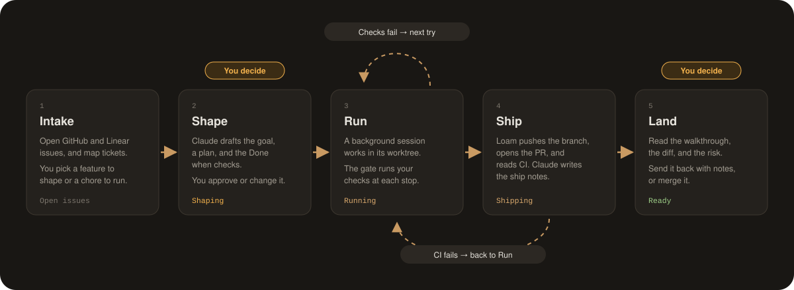
</p>

### Today

Today is the home page for runs. Click Today in the sidebar. It has four parts:

- **Your desk.** The decisions that wait for you: drafts to approve (Shape), runs to merge (Land), and runs that stopped. ⌘↩ opens the desk.
- **The line.** The runs of each plot, by station. Click a run to open its page.
- **While you were away.** The run events since you last looked at Today.
- **Limits.** The runs at a time, the turns and tries of each run, the usage hold, and who merges.

The sidebar card at the bottom shows the running runs, the week's usage of Claude Code, and the next recurring run.

<p align="center">
  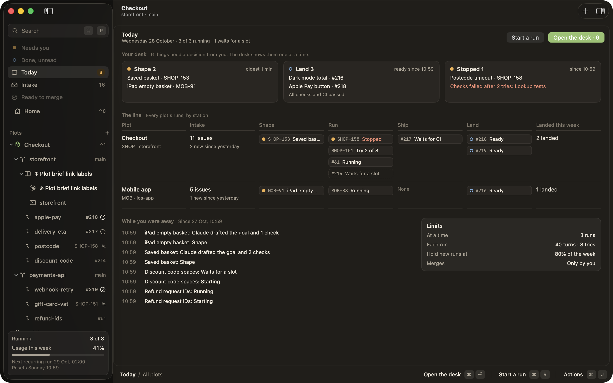
</p>

### Intake

Intake lists the open work of a plot. Click Intake in the sidebar. It shows:

- The open issues of the plot's GitHub repos, through `gh`.
- The open issues of the plot's Linear team and project links, when Loam has a Linear key. See [Linear](#linear).
- The open tickets of the wayfinder maps in the plot's links. A map is a local link to a file called `map.md`, with a file for each ticket in the `issues` folder next to it.

The filters narrow the list to the issues assigned to you, or to the issues in this cycle. The source switch shows one source at a time.

Click an item to see its detail card. Then:

- **Shape with Claude** has Claude draft a run from the item.
- X checks more than one item. The bar at the bottom then acts on all of them: Kind "Feature: Shape first" has Claude draft each run, and "Chore: start now" starts each one at once. ⌘↩ shapes the checked items.
- **Start as a chore** opens the start form. You write the goal and the Done when checks, and the run starts at once. It skips Shape. A chore is small work with known checks, such as "Bump the Go version".

On Today, ⌘R (Start a run) opens Intake. To start a run that has no issue, use `loam run start` in a terminal.

<p align="center">
  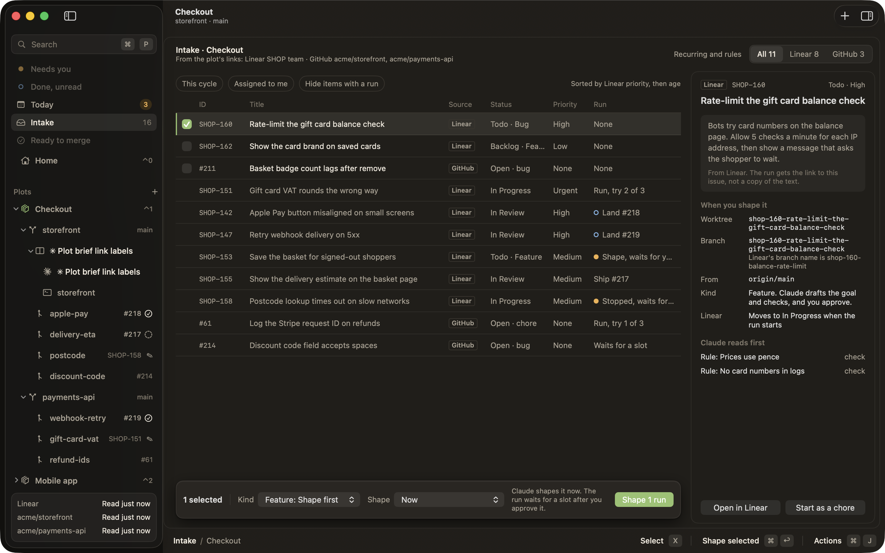
</p>

### Shape

At Shape, Claude reads the issue and the plot, and drafts the run:

- The goal, in a few sentences.
- A plan.
- The Done when checks: shell commands that pass when the work is done, such as `go test ./...`.
- The repo, and the base branch.

You see the draft at the desk. You can edit each part. Then choose one:

| Key | Does |
| :- | :- |
| A | Approve and next: start the run with the draft and your edits |
| C | Ask Claude to change it: Claude drafts the run again with your note |
| N | Not now: cancel the run. The issue stays open. |

When an issue touches more than one repo of the plot, set Shape to "Split across the repos" in the bar at the bottom of Intake before you shape it. Claude drafts one run for each repo. The runs are a group, and each one links to the others.

<p align="center">
  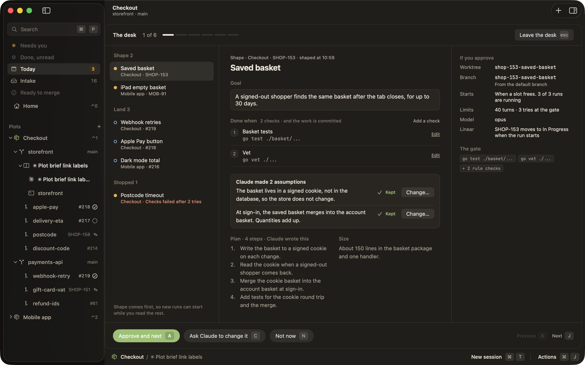
</p>

### Run

When a run starts, Loam makes a worktree for it on a new branch, runs the repo's setup command, and starts a background Claude Code session in it. The session gets the seed of the plot, so it knows the work.

The gate runs each time the session ends a turn:

1. Loam runs the Done when checks of the run in the worktree, then the rules of the plot.
2. If every check passes, the run goes to Ship.
3. If a check fails, Loam sends the output back to the session. That is the next try.
4. When the run has used all its tries, it stops and waits for you at the desk.

The run page shows the goal, the checks, the tries and turns, and the history. Watch opens a tab attached to the background session, so you can see it work. Stop run stops the session.

Each plot has a default model and effort for its runs. Set them under "Model and effort" on the Recurring and rules page of the plot. The start form of a chore sets the model, the effort, and the tries of one run.

<p align="center">
  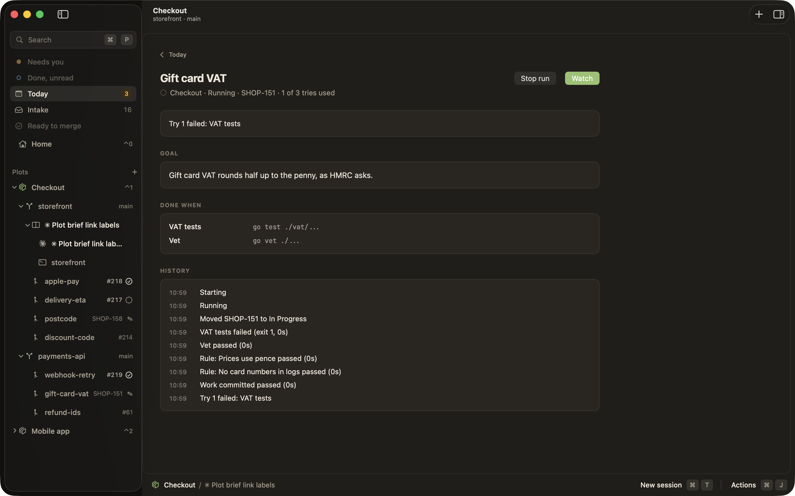
</p>

### Ship

When every check passes in a repo on GitHub, the run ships:

1. Loam pushes the branch.
2. Claude writes the PR title and body. When the repo has a PR template, Claude fills it in.
3. Claude also writes the ship notes for you: a walkthrough, the changed files in the order to read them, and a risk level with its reasons. Loam adds facts that it finds itself, such as a changed store migration or changed dependency files.
4. Loam opens the PR and reads CI.
5. If CI fails, Loam sends the failures back to the session as a try. The run goes round the gate again.

When CI passes, the run is Ready, and it comes to the desk. A run in a repo that is not on GitHub goes to Ready when its checks pass, with no PR.

### Land

At the desk, a Ready run shows:

- The walkthrough that Claude wrote.
- The changed files, in the order to read them, and the diff of each one.
- The evidence: the Done when checks and CI, with the try that passed.
- The risk, with its reasons.
- When you merge: the steps that Loam takes after the merge.

Click a line number to add a note on that line. Then choose one:

| Key | Does |
| :- | :- |
| ⌘↩ | Merge the PR |
| S | Send back: resume the session with your notes. The gate and CI run again before the run comes back. |

A note is not a failure, so it uses no try. When you send back a note like one that you sent back on another run of the plot, Loam offers to make it a [rule](#rules).

After a merge, Loam can remove the worktree and the branch, and move Where it stands on. Both are boxes under "When you merge". When GitHub merges the PR outside Loam, the next tick sees it and lands the run.

<p align="center">
  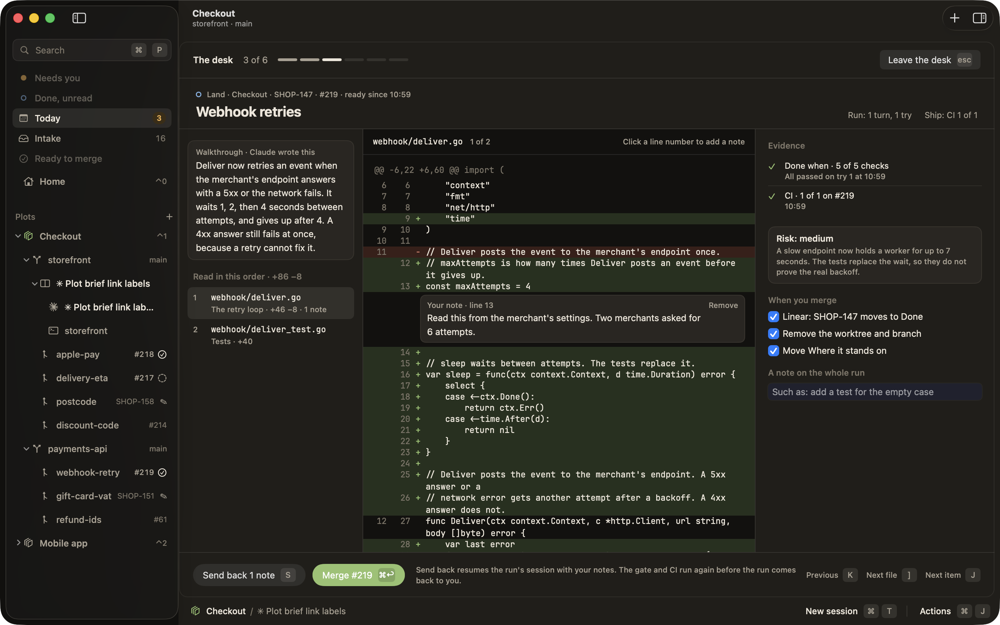
</p>

### Limits and usage

Open Settings (⌘,) and choose Runs. The limits apply to every run:

| Limit | Default | Does |
| :- | :- | :- |
| At a time | 3 | The number of runs that work at once. A new run waits in Queued ("Waits for a slot") until a run ends. |
| Turn limit | 40 | The turns that a run can take after each start or resume. Then the run stops. 0 is no limit. |
| Hold at | 80% | When the week's usage of Claude Code is at this share or more, new runs wait in Queued. 0 turns the hold off. |

Each run also has tries: the failed gates that it can have before it stops. The default is 3, and the start form of a chore can change it.

Claude Code reports its usage to each `claude -p` call that Loam makes. The Runs tab shows the last report. When the report is more than 30 minutes old and the hold needs it, Loam asks again with a small call that uses Haiku.

<p align="center">
  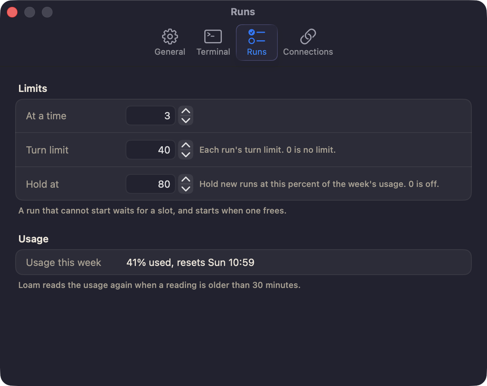
</p>

### Rules

A rule is a check that every run of a plot must pass, such as "Views use the colour tokens". The gate runs the rules after the checks of the run. Loam keeps the rules outside the worktree, so a run cannot change them.

To see and edit the rules of a plot, choose Recurring and rules on its Intake page. In a terminal, use `loam rule`.

### Recurring runs

A recurring run starts on a timetable, such as each weekday at 06:30. To add one, choose Recurring and rules on the Intake page of a plot.

- A precheck is a shell command that decides whether there is work. When it fails, the run is Skipped and no session starts. Skips in a row show as one Skipped run.
- A Shape recurring run has Claude draft a run for you to approve. A chore recurring run starts the run, which works to its gate and then waits for you to land it.
- Runs never stack: the next run waits until the last one ends.
- A time that the Mac slept through starts once, when it wakes. You can choose to skip it.

While Loam is open, it starts the recurring runs that are due. To start them while Loam is closed, turn on "Start recurring runs while Loam is closed". Loam then has launchd run `loam tick` every 5 minutes while you are logged in.

<p align="center">
  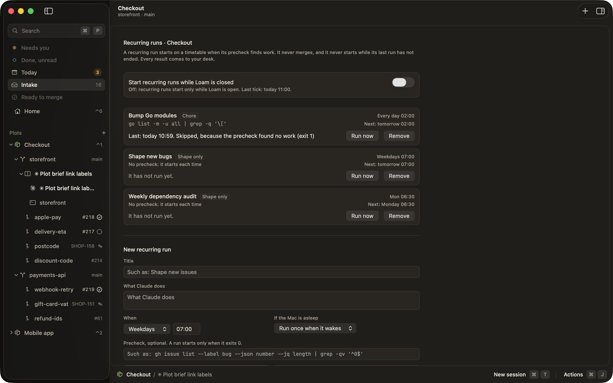
</p>

### Linear

Loam reads and updates Linear with a personal API key. Open Settings (⌘,), choose Connections, and paste the key. Loam keeps it in the macOS Keychain, and passes it to the core on stdin. The app never reads the key back.

With a key, add a link to a Linear team or project to a plot. Its open issues then show in Intake. "What each plot reads" in Settings > Connections shows the scope of each plot.

Loam writes to Linear only on these events. Each one is a switch under "Updates to Linear" in Settings > Connections:

- When a run starts, move the issue to In Progress.
- When the PR opens, attach it to the issue.
- When you land a run, move the issue to Done.
- When you land a run, add its walkthrough as a comment.

Each write is an event of the run, with its result. A failed write never stops a run.

<p align="center">
  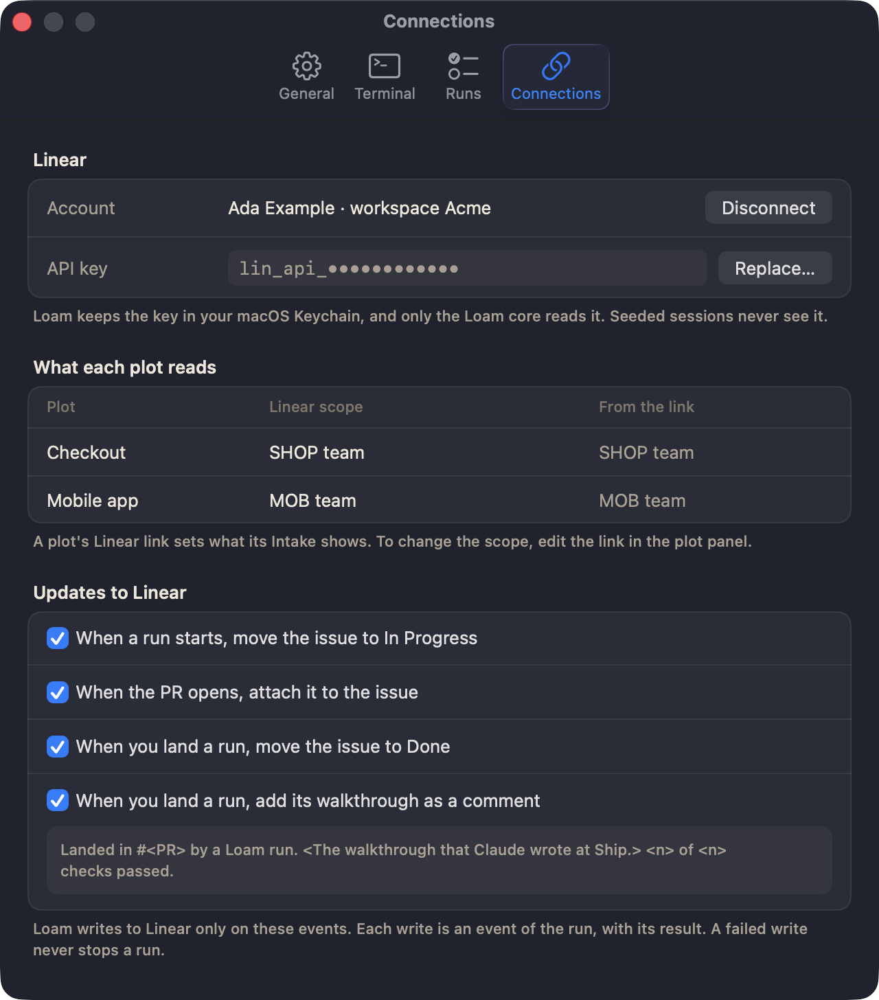
</p>

## The terminal

Loam is a full terminal on libghostty. You can start interactive Claude Code sessions in a plot next to its runs.

### Your terminal, in your theme

Loam runs on libghostty, so your Ghostty config applies: the font, the keys, and the theme. The window takes its colours from the terminal theme, and it changes as soon as you reload the config. With no config, Loam uses its own Night and Day themes.

<p align="center">
  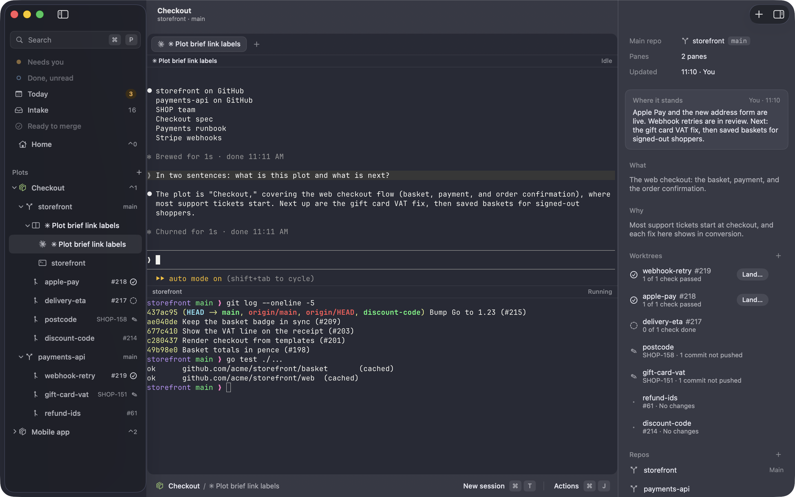
  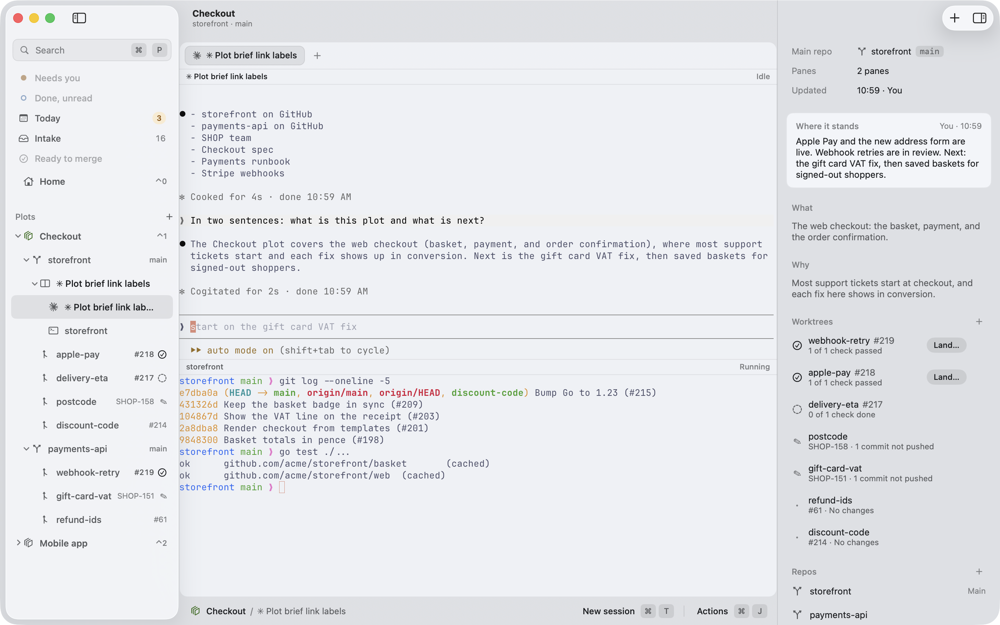
</p>

### Every session in its place

The sidebar shows each plot as a tree: each repo, its worktrees under it, and the panes that run in each one. ⌘T starts a seeded Claude Code session in the main repo of the active plot. "New session" on the plot row starts one in the plot folder, with every repo added. A worktree gets its own branch, and Loam runs your setup command in it.

### A signal when a session needs you

A pane whose session waits on you, for example at a permission prompt, turns amber. The sidebar lists it under "Needs you", and its plot shows a count, even when the plot is not on screen. ⌘L takes you to the next pane that needs you. A pane that finished a turn that you have not seen shows a blue ring.

<p align="center">
  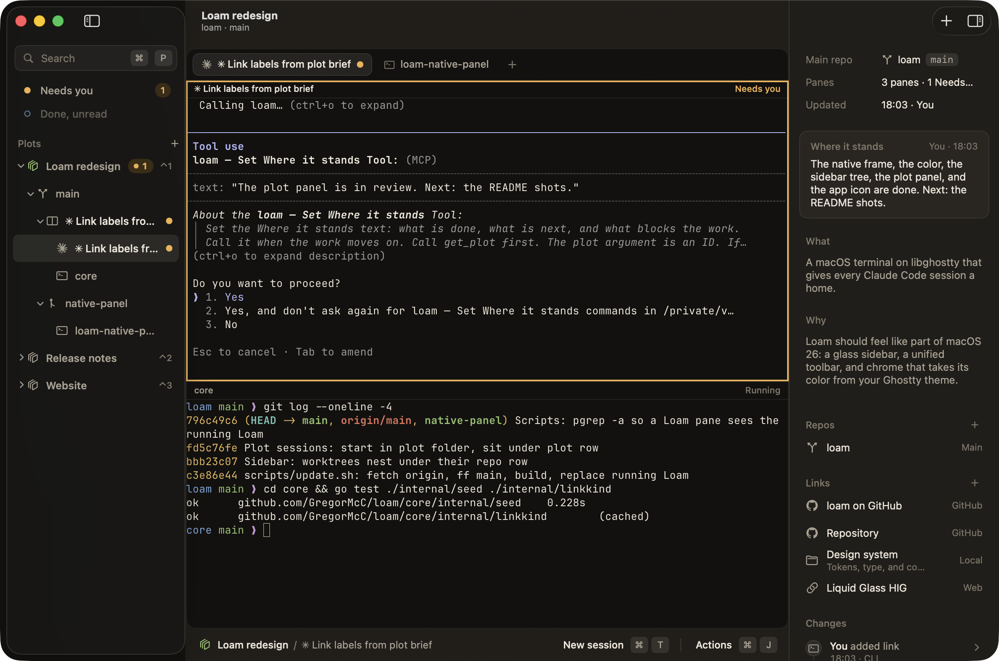
</p>

### Review what Claude changed

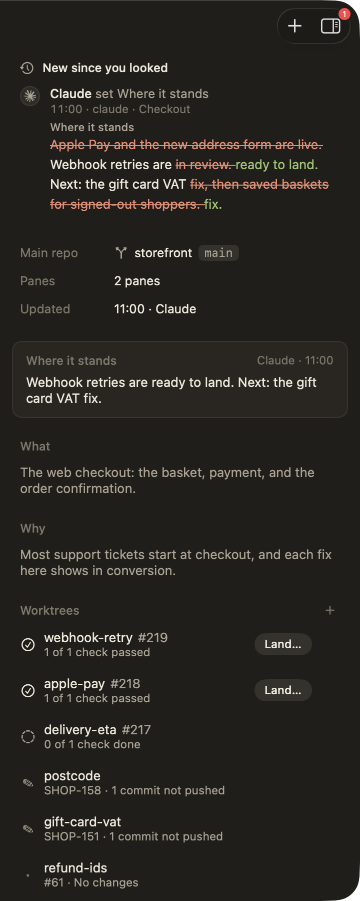

The plot panel (⌘I) holds the brief, the repos, and the links, and you can edit all of them. When a session changes the plot, the change shows under "New since you looked", with the diff. The change log keeps every change, and Undo reverses one.

The diff shows the words that Claude removed and added. Read it, then keep the change or undo it.

<br clear="right">

### See how far each branch is from merged

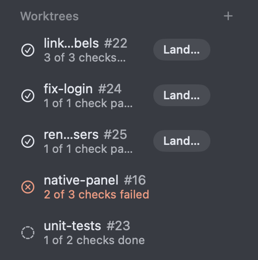

A worktree that has a pull request (PR) shows the PR number and a stage mark in the sidebar. The stage is one step on the way to Merged, such as Checks running, Approval needed, or Ready to merge. A worktree with no PR and work that is not pushed shows ✎ in the sidebar.

The plot panel has a Worktrees section. Each row has the stage mark, the branch, the PR number, and a status line such as "2 of 3 checks failed". The "Ready to merge" row in the sidebar counts the ready worktrees in all plots. ⇧⌘L goes to the next one.

Ship state does not raise an alert. Only Conflicts and Checks failed take a warning colour.

Loam reads GitHub through `gh` and holds no GitHub credentials. It refreshes the state when you open a plot and after a session stops. It refreshes the active plot every minute while Loam is in front, and the other plots every 5 minutes.

<br clear="right">

### Read the checks, then send the fix

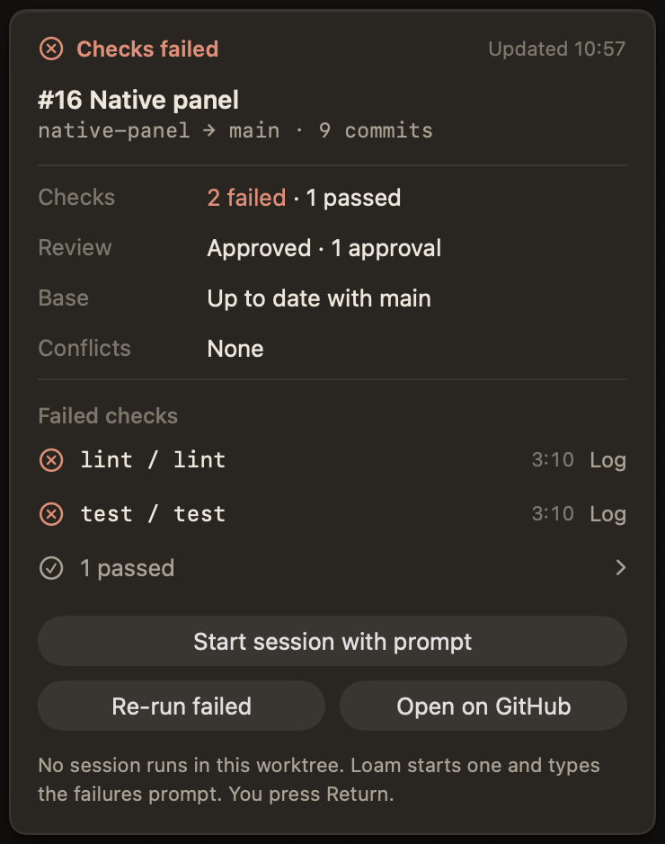

Click a stage mark to open the PR popover. It shows the stage, the checks, the review, the base branch, and conflicts. Each failed check has a Log link. Re-run failed and Update branch act on GitHub. Open on GitHub opens the PR in your browser.

When a PR has failed checks, requested changes, or conflicts, the popover has a button such as "Send failures to session". Loam types a short prompt into the Claude Code session of the worktree and never presses Return. You press Return to send it.

Loam types only when the session is idle and its input is empty. Otherwise the button is "Copy prompt". A worktree with no session gets "Start session with prompt".

<br clear="right">

### Land from one sheet

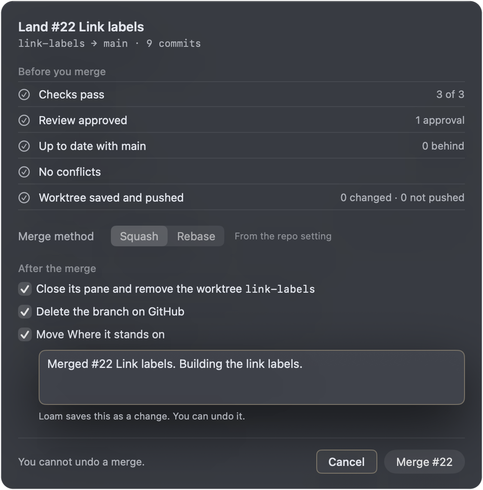

A worktree at Ready to merge has a Land… button. It is in the PR popover, on the row of the worktree in the plot panel, and in the actions menu (⌘J).

The Land sheet lists each item that can block the merge: checks, review, base, conflicts, and local work. Merge stays off while an item blocks. The sheet offers the merge methods that the repo allows.

After the merge, these boxes are on by default:

- Remove the worktree. When a pane runs in it, Loam closes the pane first.
- Delete the branch on GitHub.
- Move Where it stands on. Loam saves this as a change that you can undo.
- Remove the issue from the plot's links, for a worktree that started from a link.

If checks still run, the button is "Merge when ready". With a merge queue, it is "Add to merge queue".

<br clear="right">

### After a merge on GitHub

A PR can merge outside Loam: a reviewer merges it, or the merge queue does. When a refresh finds the merge, Loam acts as the repo setting "After a merge on GitHub" says. The setting is in the Repo actions menu of a repo in the plot panel.

| Setting | What Loam does |
| :- | :- |
| Ask (the default) | Shows a callout at the top of the plot panel, with Keep and Remove worktree. |
| Remove the worktree | Removes the worktree when that is safe. When it is not safe, Loam asks. |
| Do nothing | Shows the worktree as Merged in the plot panel, with a Remove… button. |

Loam removes a worktree with no click only when all of these are true:

- The worktree has no changed files and no unpushed commits.
- Git reports the state of the worktree with no error.
- No session is in a turn or waits on you.
- No shell pane runs a command.

### Start work from a link

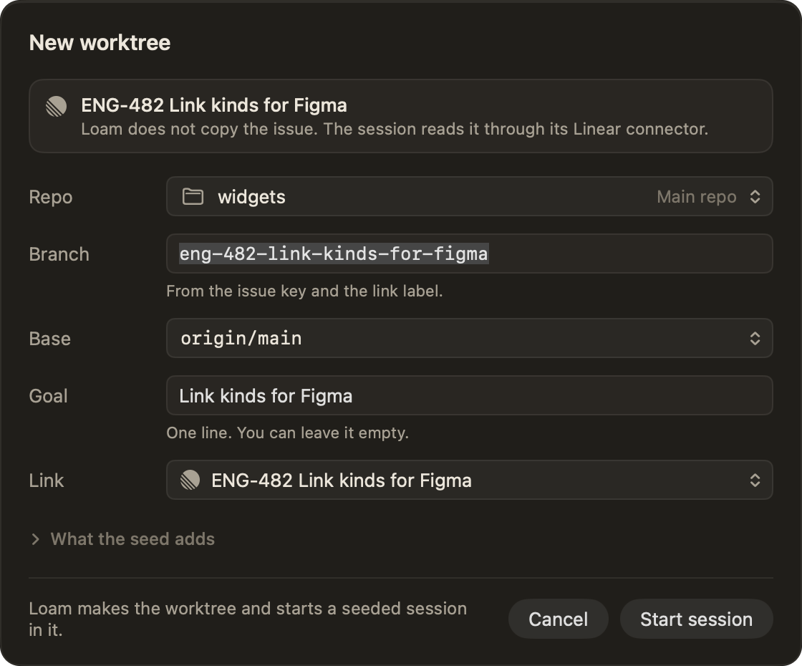

A Linear issue link or a GitHub issue link starts interactive work in one step. Open the Link actions menu of the link in the plot panel and choose Start work…, or press ⌘Return on the link in the quick switcher. The New worktree sheet fills in the branch and the goal from the link. Start session makes the worktree and opens a seeded session in it.

<br clear="right">

### Go anywhere from the keyboard

The quick switcher (⌘P) finds plots, panes, links, and commands, and shows a preview of the selected one. The actions menu (⌘J) lists the commands for the pane and the plot, with their keys. ⌃1 to ⌃9 go straight to a plot.

<p align="center">
  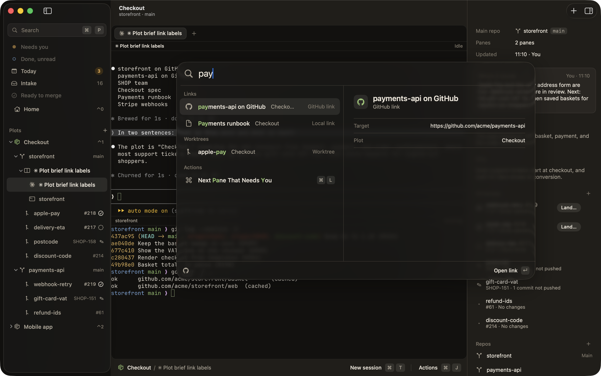
</p>

### Your layout comes back

Quit and reopen, and your tabs and splits come back. Each session resumes when you show its plot.

## Keys

| Key | Does |
| :- | :- |
| ⌘↩ | On Today: open the desk. In Intake: shape the selected items. At the desk: merge. |
| ⌘R | On Today: start a run |
| X | In Intake: select an item |
| A, C, N | At the desk, Shape: approve, ask Claude to change it, not now |
| S | At the desk, Land: send back with your notes |
| J, K | At the desk: next item, previous item |
| ] | At the desk: next file |
| esc | Leave the desk |
| ⌘T | New Claude Code session in the active plot |
| ⌥⌘T | New shell tab |
| ⌘D, ⇧⌘D | Split right, split down |
| ⌘P | Quick switcher |
| ⌘Return | In the quick switcher: start work from the selected issue link |
| ⌘J | Actions menu |
| ⌘L | Next pane that needs you |
| ⇧⌘L | Next worktree that is ready to merge |
| ⌃0 | Home |
| ⌃1 to ⌃9 | Go to plot 1 to 9 |
| ⌘N | New plot |
| ⌘B | Show or hide the sidebar |
| ⌘I | Show or hide the plot panel |
| ⌘, | Settings |

The tab and split keys are Ghostty's. If your Ghostty config binds them to other keys, Loam uses yours. The other keys belong to Loam.

## Install and update

The [README](../README.md#install) has the install command. These are the other details:

- If `~/.local/bin` is not on your PATH, the install script says how to add it.
- To update, run the install command again. If a session is in a turn, Loam asks first, and the script waits up to 10 minutes for your answer. You can run it from inside a Loam pane: the pane closes when Loam quits, and the log is `~/Library/Logs/loam-update.log`.
- When the version is installed already, the script does nothing. To install one version, run `curl -fsSL https://raw.githubusercontent.com/GregorMcC/loam/main/scripts/install-release.sh | sh -s -- --version vX.Y.Z`. Add `--force` to install the same version again.
- `loam setup` prints allow rules for the Loam read tools. Add them to `permissions.allow` in your Claude Code settings. Loam does not edit that file.
- A self-signed certificate signs each release. It is not an Apple Developer ID, so Gatekeeper does not know it. `curl` does not mark the download for Gatekeeper, so the app opens. If you download `Loam.zip` with a browser, macOS blocks the first launch. Then open System Settings > Privacy & Security and click Open Anyway.

## Build from source

You need:

- macOS 26 or later
- Xcode 26.5 or later, with the Metal Toolchain: `xcodebuild -downloadComponent MetalToolchain`
- Go 1.26 or later: `brew install go`
- Claude Code, with `claude` on your PATH

```sh
git clone https://github.com/GregorMcC/loam.git
cd loam
scripts/make-signing-cert.sh     # once, if you have no Apple Development certificate
scripts/install.sh app           # builds the loam CLI and /Applications/Loam.app
loam setup                       # once: registers the Loam MCP server with Claude Code
open /Applications/Loam.app
```

- The signing certificate lets macOS keep Loam's folder permissions across updates. `scripts/install.sh app --adhoc` skips it, but then macOS can ask for access again after each update.
- To update, run `scripts/update.sh`. It fetches `origin`, fast-forwards `main`, and builds and installs the new Loam. The checkout must be on `main` with no uncommitted changes. If Loam runs, the script builds first, then quits Loam, installs, and opens it again. The log is `~/Library/Logs/loam-update.log`. To remove Loam, run `scripts/uninstall.sh`.

## Make a release

`scripts/release.sh vX.Y.Z` tags `main`, builds the CLI and the app, and signs both with the "Loam Local Signing" certificate. It publishes `Loam.zip` and its SHA-256 as a GitHub release. `scripts/release.sh vX.Y.Z --dry-run` builds the zip and pushes nothing.

Every release must use the same certificate, because macOS keeps a person's folder permissions only while the signature stays the same. `install-release.sh` refuses an app with another signature. Keep a `.p12` backup of the certificate: in Keychain Access, export "Loam Local Signing".
