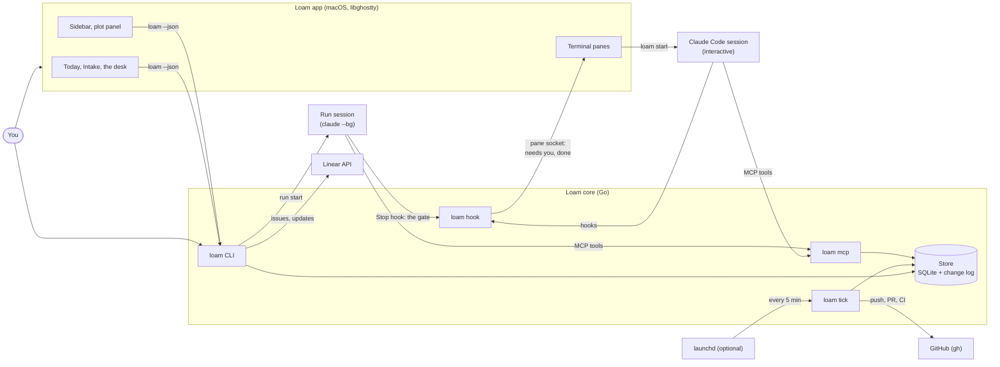

# How Loam works

This page describes the parts of Loam and how they talk. To use Loam, see the [guide](guide.md).

## The parts



- **The app** is AppKit and SwiftUI on libghostty. It shows Today, Intake, the desk, the sidebar, the plot panel, and the terminal panes. It reads and writes all data through the CLI.
- **The core** is one Go binary, `loam`. It holds the store (SQLite and the change log), the CLI, the MCP server (`loam mcp`), the hooks (`loam hook`), and the tick (`loam tick`).
- **A run session** is a background Claude Code session that Loam starts with `claude --bg` in the run's worktree. Its Stop hook is the gate.
- **The tick** ships the runs whose checks passed, starts queued runs, starts recurring runs that are due, and lands runs whose PR merged on GitHub. The app runs it while it is open. `loam tick install` has launchd run it every 5 minutes while you are logged in.

## The decisions

The decisions are in [docs/adr/](adr/):

- **The core works without the app** ([ADR 0002](adr/0002-core-works-without-the-app.md)). Use `loam` in any terminal. See [The loam CLI](cli.md).
- **The CLI is the contract** ([ADR 0004](adr/0004-go-core-and-the-cli-as-the-contract.md)). The app calls `loam --json` and reads stable exit codes. See [contract.md](contract.md).
- **Seeds hold links, not snapshots** ([ADR 0001](adr/0001-seeds-hold-links-not-snapshots.md)).
- **Sessions start in the main repo** ([ADR 0003](adr/0003-sessions-start-in-the-main-repo.md)). A run starts in its own worktree.
- **Sessions end with the Loam app** ([ADR 0005](adr/0005-sessions-end-with-the-loam-app.md)). Run sessions are background sessions, so they do not.
- **Loam has a settings file** ([ADR 0006](adr/0006-loam-has-a-settings-file.md)).
- **Ship state is information** ([ADR 0007](adr/0007-ship-state-is-information.md)). The core reads GitHub through `gh` and decides the stage. The app shows the stage and raises no alert for it.

## What a plot holds

| Part | What it is |
| :- | :- |
| **Brief** | Three short parts. *What* the work is, *why* it matters, and *where it stands*. What and Why rarely change. Where it stands moves with the work. |
| **Repos** | Local git checkouts. One is the **main repo**, where sessions start. A repo can belong to many plots. |
| **Links** | Labelled pointers to Notion pages, Linear issues and teams, GitHub, Obsidian vault notes, URLs, and local folders. A seed holds the links, never their content. |
| **Worktrees** | Separate checkouts of a repo, each on its own branch, that Loam makes for the plot. A worktree has a goal, and it can point at an issue link. Each run has its own worktree. |
| **Runs** | The goals that background sessions work on. See [The life of a run](#the-life-of-a-run). |
| **Rules** | Checks that every run of the plot must pass. Loam keeps them outside the worktrees. |
| **Recurring runs** | Runs that start on a timetable. |
| **Change log** | Every edit to the plot, by you or by a session, with who and when. Undo adds a change. It never removes one. |

## What a session sees

The seed is a `CLAUDE.md` that Loam writes for the plot. It loads when a session or a run starts, and again after `/compact`:

```markdown
# Plot: Checkout

## How to use this plot

- This session belongs to the plot "Checkout". The plot has a brief, repos, and links.
- The plot can change while you work. Before you rely on a plot detail, call `get_plot`.
- If this session is not a Loam run: to change the plot, use the Loam MCP tools (`mcp__loam__*`), not the `loam` CLI. Loam records each change in the change log. When the work moves on, call `set_where_it_stands` with your proposed text.
- If this session is a Loam run: it has only the read tools of the Loam MCP server, so do not try to change the plot. Report in your last message: Loam keeps that.
- A link is a pointer, not content. Fetch a link only when the task needs it, through your own connectors.
- If your folder is one of these worktrees, its goal is your task.
- When you open a PR from a worktree with a link, put Fixes and the link key in the body, such as Fixes SHOP-142 or Fixes #57.

## Brief
### What   ...
### Why    ...
### Where it stands   ...

## Repos
- `~/Code/storefront`: the web shop
- `~/Code/payments-api`: the payments service

## Worktrees
- storefront-shop-142-apple-pay-button: Apple Pay button misaligned on small screens (SHOP-142, from origin/main)

## Links
- [acme/storefront](https://github.com/acme/storefront): the repo on GitHub
```

A run session also gets the goal of the run, its Done when checks, and the rules of the plot in its first prompt.

## The life of a run

| State | What it means |
| :- | :- |
| Shaping | Claude drafted the run. It waits for you to approve its goal and its checks. |
| Queued | It waits for a slot: the run limits or the week's usage hold its session. A tick starts it when a slot is free. Its note says why it waits. |
| Starting | Loam is starting its session. |
| Running | Its background session is in a turn, or between the turns that its gate asks for. |
| Shipping | It passed its gate. Loam pushes its branch, opens its PR, and waits for CI. A CI failure sends it back to Running with a try. |
| Ready | It waits for you to land it: its gate passed, and CI passed on its PR, or it has no PR. |
| Stopped | It used all its tries or its turns, or a failure stopped it. |
| Limited | Claude Code hit a usage limit. This does not count a try. |
| Start unknown | Loam lost track of its start. Loam reads the background sessions before it starts the run again, so a prompt never goes twice. |
| Landed | Its PR merged. |
| Cancelled | You stopped it. |
| Skipped | A recurring run whose precheck found no work. |

Shaping, Ready, Stopped, and Limited need you, so they come to the desk. Send back moves a Ready or Stopped run back to Running with your notes.
